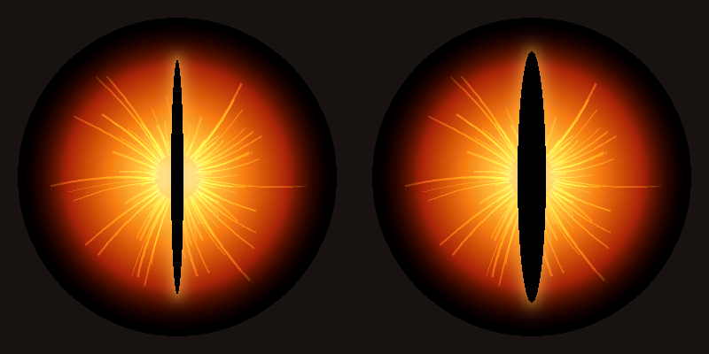

# Olho de Sauron

Um olho de Sauron numa torre Barad-dûr impressa em 3D. A íris aparece numa tela redonda de 360×360 e a pupila segue as pessoas que a câmera vê passar.



## Hardware

| Peça | Função |
|---|---|
| Seeed XIAO ESP32-C6 | Desenha o olho e move a pupila |
| Tela redonda GC9B72 de 1,8" (360×360, SPI) | Mostra a íris e a pupila |
| ESP32-CAM (OV2640) | Detecta movimento e manda a posição da pessoa |
| Programador ESP32-CAM-MB (CH340) | Só para gravar o ESP32-CAM |

## Ligações (protoboard)

A tela encaixa na mesma fileira de cada pino do XIAO (de D6 a D0, com o USB virado para baixo), então os sinais SPI não precisam de jumper.

| XIAO | GPIO | Tela |
|---|---|---|
| D6 | 16 | SCL |
| D5 | 23 | SDA |
| D4 | 22 | RST |
| D3 | 21 | DC |
| D2 | 2 | CS |
| D1 | 1 | BL |
| D0 | 0 | SDO (só entrada, não usado) |
| 3V3 | — | VCC |
| GND | — | GND |

| ESP32-CAM | XIAO |
|---|---|
| U0TXD | D7 (GPIO 17, RX a 115200) |
| 5V | 5V (barramento +) |
| GND | GND (barramento −, comum aos três) |

Na protoboard o SPI é estável a 20 MHz. A partir de 26,7 MHz a imagem some.

## Como funciona

1. O **ESP32-CAM** (`etapa4_camera`) captura imagens de 160×120 em tons de cinza e compara cada quadro com o anterior. Quando mais de 40 pontos mudam, ele manda `X:nnn` (0 a 159) pela serial, onde X é o centro do movimento.
2. O **XIAO** (`etapa5_integracao`) lê o X pelo D7 e move a pupila até essa posição, dilatada. Se o sinal some, ela segura o olhar por 5 s. Depois disso vagueia devagar, contraída.
3. A tela usa o driver `esp_lcd` com DMA e dois buffers. Só a faixa por onde a pupila passa é redesenhada, o que dá cerca de 30 quadros/s.

### Comandos pela serial USB do XIAO (115200)

| Tecla | Ação |
|---|---|
| `r` | Gira a imagem 90° (fica salvo) |
| `e` | Inverte o espelhamento (fica salvo) |
| `v` | Troca a velocidade do SPI (10 / 20 / 26,7 / 40 MHz) |
| `s` | Liga/desliga o relatório a cada 2 s |
| `c` | Liga/desliga o eco das linhas da câmera |
| `d` | Força a pupila a dilatar/contrair |

## Pastas

| Pasta | O que é |
|---|---|
| `etapa1_tela` | Primeiro teste da tela: ciclo de cores com a Arduino_GFX |
| `etapa2_iris` | Íris estática |
| `etapa3_pupila` | Pupila animada com `esp_lcd` e DMA |
| `etapa4_camera` | Firmware do ESP32-CAM: detecção de movimento → `X:nnn` |
| `etapa4_visual` | Variante do ESP32-CAM que manda a imagem pela USB para o `ver_camera.py` (não ligar no XIAO) |
| `etapa5_integracao` | **Firmware atual do XIAO**: a pupila segue a câmera |
| `ferramentas/gerar_iris.py` | Gera `iris.h`, `pupila.h` e as prévias em `previa/` |
| `ferramentas/ler_camera.py` | Lê a serial do ESP32-CAM (solta DTR/RTS) |
| `ferramentas/ver_camera.py` | Janela ao vivo do que a câmera vê e detecta, e grava um vídeo |
| `diag_tela`, `teste_*` | Diagnósticos usados para fazer a tela funcionar (alguns usam a pinagem antiga, com jumpers) |

## Compilar e gravar

São necessários o [arduino-cli](https://arduino.github.io/arduino-cli/), o core `esp32:esp32` 3.3.12 e a biblioteca *GFX Library for Arduino* 1.6.9.

**XIAO ESP32-C6:**

```sh
arduino-cli compile --fqbn esp32:esp32:XIAO_ESP32C6:CDCOnBoot=cdc --upload -p /dev/ttyACM0 etapa5_integracao
```

**ESP32-CAM:** com o programador ESP32-CAM-MB, só a gravação lenta funcionou:

```sh
arduino-cli compile --fqbn esp32:esp32:esp32cam --output-dir etapa4_camera/build etapa4_camera
B=etapa4_camera/build
ESPTOOL=$(ls -d ~/.arduino15/packages/esp32/tools/esptool_py/*/)esptool
$ESPTOOL --chip esp32 --port /dev/ttyUSB0 --baud 115200 --no-stub write-flash --flash-mode dio \
  0x1000 $B/etapa4_camera.ino.bootloader.bin 0x8000 $B/etapa4_camera.ino.partitions.bin \
  0xe000 ~/.arduino15/packages/esp32/hardware/esp32/3.3.12/tools/partitions/boot_app0.bin \
  0x10000 $B/etapa4_camera.ino.bin
```

**Ferramentas Python:** precisam de `numpy` e `pillow`, além de `tkinter` e `ffmpeg` para o `ver_camera.py`.

```sh
python3 ferramentas/ver_camera.py capturas/meu_teste
```

## Andamento

- [x] 1. Tela funcionando
- [x] 2. Íris
- [x] 3. Pupila animada
- [x] 4. Câmera detectando movimento
- [x] 5. Integração: a pupila segue a pessoa
- [ ] 6. Calibrar o comportamento (faixa do X, pessoa parada, vaguear)
- [ ] 7. Imprimir e montar a torre

## Créditos

A sequência de inicialização da tela em `Arduino_GC9B72.h` vem do componente ESP-IDF `viewesmart/esp_lcd_gc9b72` 1.0.0 (Apache-2.0, © 2023 Espressif Systems, © 2026 VIEWE).
